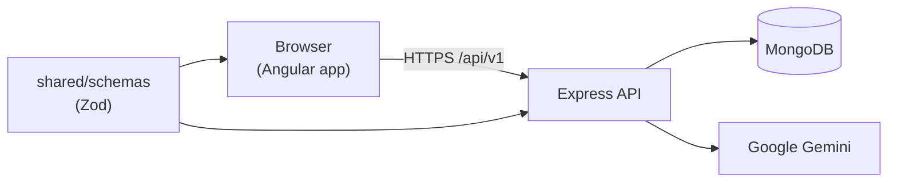

# FoodVibe

[](https://github.com/WDD-CODER/foodVibe1.0/actions/workflows/ci.yml)


FoodVibe — kitchen and food-business management: recipes and costing, events, inventory and suppliers, CRM, a front
desk and AI helpers. Hebrew, right-to-left.

## Live demo

**[foodvibe1-0-1-frankfurt.onrender.com](https://foodvibe1-0-1-frankfurt.onrender.com/)**

Hosted on Render's free tier: the first load can take about 50 seconds while the server wakes up. New accounts get
100 AI calls.

## Screenshots

| | |
| --- | --- |
|  |  |
| The dashboard: the business at a glance. | A recipe with live ingredient costing. |
|  |  |
| An event with its menu and stages. | Inventory, stock and suppliers. |
|  | |
| An AI helper drafting from free text. | |

## Features

- **Recipes and dishes with live costing** — build recipes from products and sub-recipes; cost per portion updates
  as prices and quantities change.
- **Events and menus** — plan an event from first request through quote to service, with its menu, prep sheets and
  logistics.
- **Inventory, stock counts and suppliers** — products, prices, invoices, stock counts and the suppliers behind them.
- **CRM and quotes** — clients with their history, and events that move through quote stages.
- **The front desk** — public requests and bookings, answered from the business's own knowledge base.
- **AI helpers** — menu drafts, reading invoices and stock lists, and voice notes turned into structured entries,
  always as a draft a person confirms.

## Tech stack

| Layer | Technology |
| --- | --- |
| Client | Angular 19 standalone components, signals, OnPush change detection, RTL SCSS |
| Server | Node.js, Express, Mongoose |
| Shared | One Zod schema package used by both the client and the server |
| Data | MongoDB Atlas |
| AI | Google Gemini, called only from the server |
| Tests | Karma / Jasmine (unit), Vitest + in-memory MongoDB (server), Playwright (end-to-end) |
| Hosting | Render |

## Architecture



The server validates every write with the shared schemas, so the client and the API agree on one definition of each
record. The AI key never leaves the server.

## Run it locally

```bash
pnpm install
pnpm --dir server install
cp server/.env.example server/.env
pnpm --dir server run dev:local   # API
pnpm run dev:local                # app, in a second terminal
```

Then open `http://localhost:4200/`. The settings the server needs are listed in `server/.env.example`.

## How it is tested

- **2,794 unit tests** (Karma / Jasmine) — components, services, signals and utilities of the Angular app.
- **2,013 server tests** (Vitest + in-memory MongoDB) — the API routes, validation, permissions and the AI
  endpoints against a real database engine.
- **157 end-to-end tests** (Playwright) — real user flows in the browser, including layout checks at phone and
  desktop widths.

Every pull request runs lint, build, unit, server and secret-scan checks in CI.

## How I build: an AI-assisted workflow

- Every change starts as a written plan with a problem statement, a scope it may touch and acceptance criteria.
- An orchestrator builds the plans one by one on their own branches, has each one reviewed against its plan, and
  merges it only when the checks pass.
- CI and architecture gates run on every pull request: lint, build, unit and server tests, secret scanning, and
  checks that no change breaks the project's written invariants.
- What a machine cannot judge — how a screen looks and feels — goes to me as short validation cards, and nothing
  ships until I sign them off.
- Lessons from each run become written rules, so the next plan starts from them.

## Project status

Active personal project, built and maintained by one developer since February 2026 (first commit 2026-02-01); in use
as a working kitchen tool and as a portfolio.

## License

All rights reserved — see [LICENSE](LICENSE). Viewing only.

## Author

**Dan Weibren** — [github.com/WDD-CODER](https://github.com/WDD-CODER)
