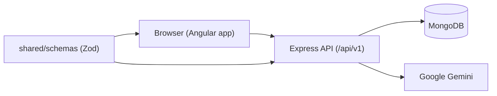

# FoodVibe

[](https://github.com/WDD-CODER/foodVibe1.0/actions/workflows/ci.yml)


FoodVibe — kitchen and food-business management: recipes and costing, events, inventory and suppliers, CRM, a front desk and AI helpers. Hebrew, right-to-left.

## Live demo

**https://foodvibe1-0-1-frankfurt.onrender.com/**

Hosted on Render's free tier: the first load can take about 50 seconds while the server wakes up. New accounts get 100 AI calls.

## Screenshots

The Hebrew, right-to-left interface is best seen in the [live demo](https://foodvibe1-0-1-frankfurt.onrender.com/).

<!--
Add each image to docs/images/, then move its two lines below out of this comment.


*The dashboard.*


*A recipe with its live costing.*


*An event and its menu.*


*The product inventory.*


*An AI helper drafting a menu.*
-->

## Features

- **Recipes and dishes:** build them from ingredients and preparations and see the cost update as you edit.
- **Events and menus:** follow an event from inquiry to finish, with its menu, venue and site logistics.
- **Inventory, stock counts and suppliers:** keep products, prices and equipment, count stock and manage suppliers.
- **CRM and quotes:** client profiles with their events and requests, and an event stage that marks when a quote was sent.
- **Front desk:** a public request page feeds a request inbox, next to bookings and a business knowledge base.
- **AI helpers:** menu drafts from free text, invoice and stock reading, and voice notes turned into text.

## Tech stack

| Layer | Technology |
| --- | --- |
| Client | Angular 19 (standalone components, signals, OnPush), RTL SCSS |
| Server | Node.js, Express, Mongoose |
| Shared | One Zod schema package used by both sides |
| Data | MongoDB Atlas |
| AI | Google Gemini, called only from the server |
| Tests | Karma / Jasmine, Vitest with in-memory MongoDB, Playwright |
| Hosting | Render |

## Architecture



The server validates every write with the shared schemas. The AI key never leaves the server.

## Run it locally

You need Node.js 22 or later, [pnpm](https://pnpm.io) and a local MongoDB.

```bash
pnpm install
pnpm --dir server install
cp server/.env.example server/.env
pnpm run build:schemas
```

Fill in `server/.env`; [`server/.env.example`](server/.env.example) explains the settings. Then start the server and the app, each in its own terminal:

```bash
pnpm --dir server run dev:local
```

```bash
pnpm run dev:local
```

Open `http://localhost:4200/`.

## How it is tested

- **2,789 unit tests** (Karma / Jasmine): the Angular app's components, services and calculation logic.
- **1,983 server tests** (Vitest with in-memory MongoDB): the API routes, permissions, data rules and AI endpoints, with the model faked.
- **157 end-to-end tests** (Playwright): user flows and screen behaviour in a real browser.

Every pull request that changes code runs lint, build, unit, server and secret-scan checks in CI.

## How I build: an AI-assisted workflow

- Every change starts as a written plan with a problem statement, a scope it may touch and acceptance criteria.
- An orchestrator builds the plans one by one on their own branches, has each one reviewed against its plan, and merges it only when the checks pass.
- CI and architecture gates run on every pull request: lint, build, unit and server tests, secret scanning, and checks that no change breaks the project's written invariants.
- What a machine cannot judge — how a screen looks and feels — goes to me as short validation cards, and nothing ships until I sign them off.
- Lessons from each run become written rules, so the next plan starts from them.

## Project status

Active personal project, built and maintained by one developer since February 2026 (first commit 2026-02-01); in use as a working kitchen tool and as a portfolio.

## License

All rights reserved — see [LICENSE](LICENSE). Viewing only.

## Author

Dan Weibren — [github.com/WDD-CODER](https://github.com/WDD-CODER)
