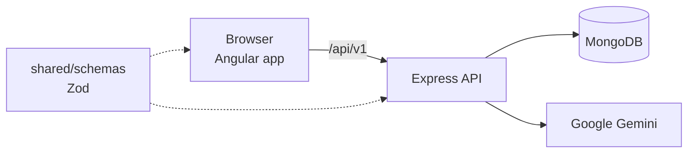

# FoodVibe

[](https://github.com/WDD-CODER/foodVibe1.0/actions/workflows/ci.yml)


FoodVibe — kitchen and food-business management: recipes and costing, events, inventory and suppliers, CRM, a front
desk and AI helpers. Hebrew, right-to-left.

## Live demo

**[Open the live demo](https://foodvibe1-0-1-frankfurt.onrender.com/)**

Hosted on Render's free tier: the first load can take about 50 seconds while the server wakes up. New accounts get
100 AI calls.

## Screenshots

The Hebrew, right-to-left interface is best seen in the [live demo](https://foodvibe1-0-1-frankfurt.onrender.com/).

<!-- Add the five files to docs/images/, then replace the sentence above with the block below (without these comment marks).


*The dashboard: the state of the business at a glance.*


*A recipe with its cost, calculated while you edit.*


*An event with its menu.*


*The product inventory.*


*An AI helper turning free input into a draft to review.*

-->

## Features

- **Recipes and dishes:** build preparations and dishes from your products and see the cost update while you edit.
- **Events and menus:** plan an event's menu and follow it with a pricing meter, prep sheets, supplier orders and a
  loading list.
- **Inventory, stock counts and suppliers:** keep products, equipment, invoices and suppliers in one place and count
  stock against them.
- **CRM and quotes:** keep client profiles and follow each event from inquiry, through quote sent and deposit paid, to
  closing.
- **Front desk:** a public request page for customers, with a requests inbox, bookings and a business knowledge base
  behind it.
- **AI helpers:** menu drafts, invoice and stock reading and voice notes turn free input into drafts that you review.

## Tech stack

| Layer | Technology |
| --- | --- |
| Client | Angular 19 (standalone components, signals, OnPush), right-to-left SCSS |
| Server | Node.js, Express, Mongoose |
| Shared | One Zod schema package used by both sides |
| Data | MongoDB Atlas |
| AI | Google Gemini, called only from the server |
| Tests | Karma / Jasmine, Vitest with an in-memory MongoDB, Playwright |
| Hosting | Render |

## Architecture



The server validates every write with the shared schemas. The AI key never leaves the server.

## Run it locally

You need Node.js 22 or later, [pnpm](https://pnpm.io) and a local MongoDB.

1. Install the app and the server:

   ```bash
   pnpm install
   pnpm --dir server install
   ```

2. Copy `server/.env.example` to `server/.env` and fill it in. Every setting is described in
   [server/.env.example](server/.env.example).
3. Build the shared schemas and start the server, then start the app in a second terminal:

   ```bash
   pnpm run build:schemas
   pnpm --dir server run dev:local
   ```

   ```bash
   pnpm run dev:local
   ```

4. Open `http://localhost:4200/`.

## How it is tested

- **2789 unit tests** (Karma / Jasmine): the app's components, services and calculations.
- **1983 server tests** (Vitest with an in-memory MongoDB): the API, permissions, data rules and AI routes, with
  the AI model faked.
- **157 end-to-end tests** (Playwright): key user flows and screen layouts in a real browser.

Every pull request runs lint, build, unit, server and secret-scan checks in CI.

## How I build: an AI-assisted workflow

- Every change starts as a written plan with a problem statement, a scope it may touch and acceptance criteria.
- An orchestrator builds the plans one by one on their own branches, has each one reviewed against its plan, and merges
  it only when the checks pass.
- CI and architecture gates run on every pull request: lint, build, unit and server tests, secret scanning, and checks
  that no change breaks the project's written invariants.
- What a machine cannot judge — how a screen looks and feels — goes to me as short validation cards, and nothing ships
  until I sign them off.
- Lessons from each run become written rules, so the next plan starts from them.

## Project status

Active personal project, built and maintained by one developer since February 2026 (first commit 2026-02-01); in use as
a working kitchen tool and as a portfolio.

## License

All rights reserved — see [LICENSE](LICENSE). Viewing only.

## Author

Dan Weibren — [github.com/WDD-CODER](https://github.com/WDD-CODER)
